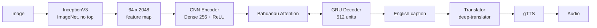

# Multilingual Visual Description and Captioning for Enhanced Accessibility

Image captioning with an InceptionV3 encoder and a Bahdanau-attention GRU decoder, plus multilingual translation and text-to-speech for accessibility.

[](https://github.com/Anudeepthi905/multilingual-image-captioning/actions/workflows/ci.yml)
[](https://colab.research.google.com/github/Anudeepthi905/multilingual-image-captioning/blob/main/notebooks/train_colab.ipynb)

**Try it:** [live demo on Hugging Face Spaces](LIVE_URL_TODO) (free CPU; the first visit after a quiet spell takes about a minute to wake up).

<!-- SCREENSHOT_TODO: replace with docs/demo.gif showing an upload, the English caption, the Telugu translation and the audio player. -->
> **Demo screenshot:** to be added after the full training run.

## The problem

Most images online have no useful alt text, and where descriptions exist they are almost always in English. People with visual impairments who read and listen in Telugu, Hindi or another regional language are left out twice. This project generates a description of a photo, translates it into the listener's language, and reads it aloud.

## How it works



The design follows *Show, Attend and Tell* (Xu et al., 2015):

| Stage | Details | Code |
|---|---|---|
| Data | MS-COCO 2014 train captions; lowercase, strip special characters, wrap in `<start> … <end>`; `TextVectorization` (vocab 5,000 by default), max length taken from the data; 80/20 split **by image** | [src/data.py](src/data.py) |
| Features | 299×299, `inception_v3.preprocess_input`, 8×8×2048 → 64×2048, cached as `.npy`. Swappable: `--backbone resnet50` (224×224, 7×7×2048 → 49×2048) | [src/features.py](src/features.py) |
| Model | `CNN_Encoder` (Dense 256 + ReLU), `BahdanauAttention` (W1, W2, V, softmax over locations), `RNN_Decoder` (Embedding 256 → concat context → GRU 512 → Dense → Dense vocab). Masked sparse cross-entropy, Adam, teacher forcing | [src/model.py](src/model.py) |
| Training | `tf.data`, `CheckpointManager` (resumable), per-epoch train/val loss and time, loss curve | [src/train.py](src/train.py) |
| Inference | Greedy and beam search (beam 3), attention heatmap per word | [src/caption.py](src/caption.py) |
| Evaluation | Corpus BLEU-1..4 (smoothed), METEOR, ROUGE-L, WER on held-out images | [src/evaluate.py](src/evaluate.py) |
| Accessibility | Translation with English fallback; gTTS speech as in-memory MP3 | [src/accessibility.py](src/accessibility.py) |
| App | Streamlit, large type, high contrast, keyboard focus, real alt text, live-region captions | [app.py](app.py) |

Languages: Telugu, Hindi, English, Tamil, Kannada, Marathi, French, Spanish, German.

## Quickstart

### Run on Colab (recommended for training)

Open [notebooks/train_colab.ipynb](notebooks/train_colab.ipynb) in Colab with a T4 GPU. It clones this repo, prepares 6,000 images, caches features for both backbones, trains, evaluates and uploads the best run to a Hugging Face model repo for the demo.

### Local install

```bash
git clone https://github.com/Anudeepthi905/multilingual-image-captioning.git
cd multilingual-image-captioning
python -m venv .venv && source .venv/bin/activate   # Windows: .venv\Scripts\activate
pip install -r requirements-dev.txt
pytest -q
```

`requirements.txt` installs the CPU-only `tensorflow-cpu` 2.17.1, which is enough for the app, tests and small runs. For GPU training use Colab (the notebook keeps Colab's own TensorFlow) or install `tensorflow==2.17.1` on Linux/WSL2. On Windows, if the repo sits in a long path (for example inside OneDrive), checkpoint saving can hit the 260-character path limit; point the artifact folders somewhere short:

```powershell
$env:MIC_DATA_DIR="C:\mic\data"; $env:MIC_FEATURES_DIR="C:\mic\features"; $env:MIC_CHECKPOINT_DIR="C:\mic\checkpoints"
```

### Prepare data, train, evaluate

```bash
# downloads captions_train2014.json (~240 MB zip) and only the images you need
python -m src.data --num-images 6000            # add --full-zip for 30k+ images

python -m src.train --backbone inceptionv3 --vocab-size 5000 --num-images 6000 --epochs 20
python -m src.train --backbone resnet50    --vocab-size 5000 --num-images 6000 --epochs 20

python -m src.evaluate --run inceptionv3_v5000_n6000_e20            # greedy
python -m src.evaluate --run inceptionv3_v5000_n6000_e20 --beam 3   # beam search
python -m src.caption  --image assets/samples/<file>.jpg --plot     # caption + heatmap
```

Feature extraction runs automatically inside `src.train` (cached in `features/<backbone>/`), or ahead of time with `python -m src.features --backbone inceptionv3`.

### Launch the app

```bash
streamlit run app.py
```

The app uses the newest run in `checkpoints/`. If that folder is empty it downloads the run from the Hugging Face model repo named in `MIC_HF_MODEL_REPO` (or a zipped run at `MIC_CHECKPOINT_URL`); see [src/config.py](src/config.py). Translation and speech need an internet connection but no API keys.

The app offers four sample photos, validates uploads (JPG, PNG or WebP up to 10 MB; videos up to 25 MB), and has an "About this demo" panel with the model's training details and limitations.

## Deploy the demo (Hugging Face Spaces)

The demo runs on a free CPU Space with the Docker SDK ([Dockerfile](Dockerfile)). TensorFlow plus InceptionV3 peaks at about 580 MB resident memory on CPU (measured locally), which is too close to Streamlit Community Cloud's throttling point.

1. **Train** with the Colab notebook. Its last cell exports the run (weights only, about 26 MB with a 5,000-word vocabulary, versus about 80 MB for the training checkpoint) and uploads it to a Hugging Face model repo:
   ```bash
   python -m src.export --run inceptionv3_v5000_n6000_e20 --push your-hf-username/multilingual-image-captioning
   ```
2. **Deploy** the Space from your machine (needs `pip install huggingface_hub` and `hf auth login` with a write token):
   ```bash
   python deploy/deploy_space.py --space your-hf-username/multilingual-image-captioning \
       --model-repo your-hf-username/multilingual-image-captioning
   ```
   This uploads only the app files, uses [deploy/space_README.md](deploy/space_README.md) as the Space's README, and sets the `MIC_HF_MODEL_REPO` variable. The Space builds the image and starts.
3. **Update** later by rerunning step 2 (code) or step 1 (model, then restart the Space).

No secrets are needed for a public model repo. For a private one, add `HF_TOKEN` as a Space secret.

## Results

All numbers below are produced by `python -m src.evaluate` on each run's held-out 20% of images (never seen in training) and written to [results/metrics.csv](results/metrics.csv). The table is regenerated from that file.

<!-- RESULTS:START -->
_Pending: the full GPU training runs (InceptionV3 vs ResNet50, 6,000 images, vocab 5,000, 20 epochs) have not been run yet. This section is filled in automatically by `python -m src.evaluate`._
<!-- RESULTS:END -->

## Experimental: video descriptions

[src/video/describe.py](src/video/describe.py) samples a keyframe every few seconds with OpenCV, captions each frame with the image model and drops consecutive duplicate captions, giving a timestamped list. It describes still frames only and has no notion of motion. Available in the app under the "Video (experimental)" tab.

```bash
python -m src.video.describe --video clip.mp4 --interval 2
```

## Limitations

- **Small training subset.** The default 6,000 images is a fraction of COCO's 83k training images, so expect generic captions that lean on the most frequent phrases in the training data.
- **BLEU's known weaknesses.** BLEU rewards n-gram overlap, not meaning; a correct caption phrased differently from the five references scores low. METEOR and ROUGE-L help a little; none of them measure usefulness to a blind listener.
- **Machine translation quality varies by language.** Google Translate is generally stronger for high-resource languages (French, Spanish, German) than for Telugu, Kannada or Marathi, and errors in the English caption carry through. Translation quality is not evaluated in this repo.
- **gTTS and Google Translate need internet** and are unofficial endpoints that can rate-limit or change. The app falls back to the English caption when translation fails.
- **Free hosting.** The demo Space sleeps when idle and runs on CPU: expect about a minute to wake up and a few seconds per caption.
- **Dataset bias.** COCO images are mostly from Western Flickr users; descriptions of Indian street scenes, clothing or food are less accurate.

## Original academic project

This started as a B.Tech final-year project at **G. Narayanamma Institute of Technology & Science (GNITS), Hyderabad (2024)**, Department of Computer Science and Engineering.

- Team: Kambalapally Anu Deepthi, Shreya Arukala, Sai Amogha Uppalapati, Siri Vennela Badhe
- Guide: Dr. G. Malini Devi, Dept. of CSE, GNITS

This repository is a clean re-implementation of that work. All numbers in this README come from this code; none are copied from the original report.

## License and data

Code: [MIT](LICENSE). MS-COCO annotations are CC BY 4.0; COCO images follow the Flickr Terms of Use and are not redistributed here (sample images and their licenses are listed in [assets/samples/ATTRIBUTION.md](assets/samples/ATTRIBUTION.md)).

## References

- K. Xu et al., *Show, Attend and Tell: Neural Image Caption Generation with Visual Attention*, ICML 2015.
- D. Bahdanau, K. Cho, Y. Bengio, *Neural Machine Translation by Jointly Learning to Align and Translate*, ICLR 2015.
- T.-Y. Lin et al., *Microsoft COCO: Common Objects in Context*, ECCV 2014.
- C. Szegedy et al., *Rethinking the Inception Architecture for Computer Vision*, CVPR 2016.
