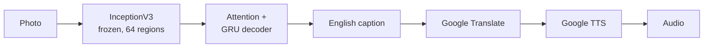

# Multilingual Image Captioning for Accessibility

Describes a photo in 9 languages, as text and speech, for people who can't see it.

[](https://github.com/Anudeepthi905/multilingual-image-captioning/actions/workflows/ci.yml)
[](https://colab.research.google.com/github/Anudeepthi905/multilingual-image-captioning/blob/main/notebooks/train_colab.ipynb)

**[Try the live demo](LIVE_URL_TODO)**

<!-- SCREENSHOT_TODO: docs/demo.gif showing an upload, the English caption, the Telugu translation and the audio player. -->

## Why

Most images online have no alt text, and the descriptions that exist are almost always in English. Blind and low-vision people who listen in Telugu, Hindi or another regional language are left out twice.

## What it does

- **Captions** a photo with an attention model (InceptionV3 encoder, Bahdanau attention, GRU decoder).
- **Translates** the caption into Telugu, Hindi, Tamil, Kannada, Marathi, French, Spanish or German.
- **Reads it aloud**, and shows it in large, high-contrast text that screen readers announce.
- **Video (experimental):** timestamped descriptions of keyframes.

## How it works



The model follows *Show, Attend and Tell* (Xu et al., 2015). For each word it weighs the 64 image regions, so it can show where it looked. It is trained on MS-COCO 2014: 6,000 images by default, split 80/20 by image. It is scored with BLEU-1 to 4, METEOR, ROUGE-L and WER on the held-out images. ResNet50 is available as an alternative encoder for comparison.

## Results

<!-- RESULTS:START -->
_Pending: the full GPU training runs (InceptionV3 vs ResNet50, 6,000 images, vocab 5,000, 20 epochs) have not been run yet. This section is filled in automatically by `python -m src.evaluate`._
<!-- RESULTS:END -->

## Run it locally

```bash
git clone https://github.com/Anudeepthi905/multilingual-image-captioning.git
cd multilingual-image-captioning
python -m venv .venv && source .venv/bin/activate   # Windows: .venv\Scripts\activate
pip install -r requirements-dev.txt
pytest -q
streamlit run app.py
```

The app needs a trained model: train one (below) or set `MIC_HF_MODEL_REPO` to a published one. Translation and speech need internet but no API keys.

## Train

The easiest way is the [Colab notebook](notebooks/train_colab.ipynb): on a T4 GPU it takes about an hour. It prepares the images, trains both encoders, evaluates them and uploads the best model to Hugging Face. To train locally instead:

```bash
python -m src.data --num-images 6000
python -m src.train --backbone inceptionv3 --num-images 6000 --epochs 20
python -m src.evaluate --run inceptionv3_v5000_n6000_e20 --beam 3
python -m src.caption --image assets/samples/dog.jpg --plot     # caption + attention heatmap
```

`requirements.txt` installs CPU-only TensorFlow; for GPU training use Colab, or `tensorflow==2.17.1` on Linux or WSL2. On Windows, inside OneDrive, point `MIC_DATA_DIR`, `MIC_FEATURES_DIR` and `MIC_CHECKPOINT_DIR` at short paths to stay under the 260-character limit.

## Deploy

The demo runs on a free Hugging Face Space. See [docs/deploy.md](docs/deploy.md).

## Limitations

- **Captions can be wrong or generic.** 6,000 images is a small part of COCO, and COCO's photos are mostly from Western Flickr users.
- **Translation and speech** use unofficial Google endpoints. They need internet, can rate-limit, and are weaker for Telugu, Kannada and Marathi. If translation fails, the app shows the English caption.
- **The metrics** measure word overlap with reference captions, not how useful a description is to a blind listener.
- **Video** descriptions caption still frames; the model has no notion of motion.
- **The free demo** sleeps when idle, so the first visit takes about a minute.

## Background

This is a re-implementation of a 2024 B.Tech final-year project at G. Narayanamma Institute of Technology & Science, Hyderabad. The team was Kambalapally Anu Deepthi, Shreya Arukala, Sai Amogha Uppalapati and Siri Vennela Badhe, guided by Dr. G. Malini Devi. Every number in this README comes from this code, not the original report.

## License

Code: [MIT](LICENSE). MS-COCO annotations are CC BY 4.0. The sample photos are CC BY 2.0 ([credits](assets/samples/ATTRIBUTION.md)). The method follows Xu et al., *Show, Attend and Tell* (ICML 2015), and Bahdanau et al., *Neural Machine Translation by Jointly Learning to Align and Translate* (ICLR 2015).
